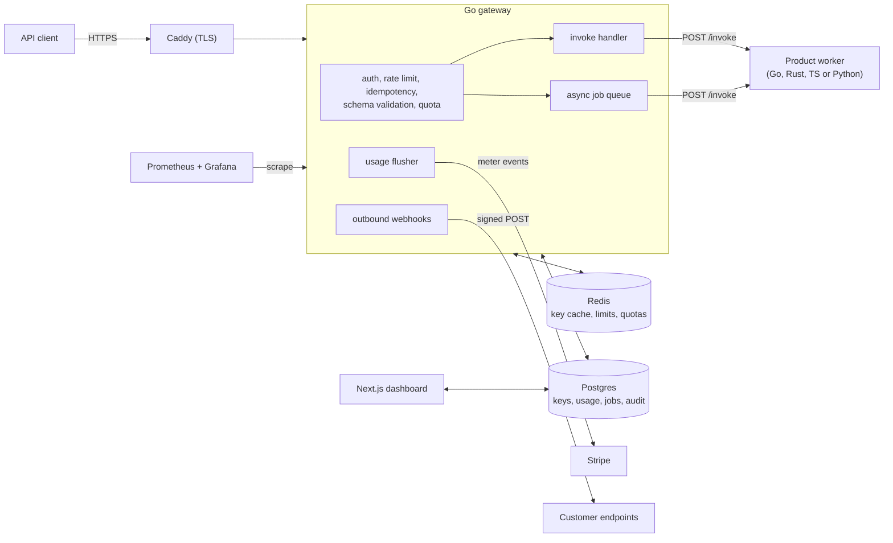

# Crucible

[](https://github.com/Unluckyathecking/crucible/actions/workflows/ci.yml)

Crucible is a template for building metered, pay-per-use HTTP APIs. Most of the work in shipping a paid API is not the product logic but everything around it: API keys, rate limits, monthly quotas, usage metering into Stripe, webhooks, async jobs, metrics and a customer dashboard. Crucible puts all of that in one Go gateway that stays the same across products, and pushes the product itself into a separate worker process behind a small, frozen HTTP/JSON contract. To start a new product you clone the repo, point it at a new worker and add a line to the route table. The worker can be written in any language that can serve HTTP.

## Architecture



A request to `POST /v1/<route>` passes through the gateway's middleware in a fixed order: API key auth (Redis-cached, Postgres-backed), error capture, a per-customer sliding-window rate limit, idempotency, optional JSON Schema validation, and a monthly quota reservation. The gateway then either calls the worker synchronously (optionally through a response cache) or, for routes marked async, enqueues a Postgres-backed job and returns `202` with a job id to poll. On success the worker reports how many billable units the call consumed, the gateway records a usage event, and a background flusher reports usage to Stripe as meter events.

Around that core the gateway also serves self-service endpoints for usage, error history, key rotation and webhook management, a read-only operator API under `/v1/admin`, Prometheus metrics, optional OpenTelemetry tracing, and its own OpenAPI 3.1 document at `/openapi.json`. The full surface is in [docs/api-reference.md](docs/api-reference.md).

## Design decisions

**One frozen worker contract.** The gateway forwards an opaque `operation` string and a JSON payload; the worker returns a payload or an error, plus `billable_units`. That is the whole interface (`gateway/proto/tool.proto` documents the shapes; nothing is generated from it, and a test in `gateway/internal/proxy` pins its field names to the Go structs). Because the gateway never learns what a product does, every clone shares the same billing, auth and limits code, and fixes to that code apply to every product the same way.

**HTTP/JSON, not gRPC.** Workers are plain HTTP servers with `POST /invoke` and `GET /healthz`, so they are debuggable with curl and writable in anything. Worker SDKs exist for Go, Rust, TypeScript and Python, and all four run against the same contract fixture (`workers/conformance/fixture.json`) in CI. Requests to the worker can optionally be HMAC-signed with a shared secret.

**The gateway enforces billing at the trust boundary.** A worker that returns success with fewer than one billable unit gets a `502 WORKER_BAD_RESPONSE` instead of a free response. Billing does not depend on every worker author getting it right.

**Stripe metering that survives crashes.** Usage rows are claimed into a batch with a stable id, and that id is the Stripe idempotency key. Pending batches are retried with the same key before new rows are claimed, so a crash between Stripe accepting a batch and the database recording it cannot bill a customer twice. Inbound Stripe webhooks are dispatched before the dedup row is written, so a transient handler failure is retried rather than lost.

**Redis for anything on the hot path.** Rate limiting is a sorted-set sliding window run as one Lua script; quotas are reserved atomically per customer per month. API key lookups are cached in Redis, and revocation goes through one code path that also clears the cache.

**Postgres as the queue.** Async jobs and outbound webhook deliveries are rows claimed with `FOR UPDATE SKIP LOCKED`, which lets several gateway replicas share the work without a separate broker. Both support per-customer fairness limits, retries with backoff and a dead-letter path.

**Boring dependencies, real databases in tests.** The gateway uses chi, pgx, go-redis, zerolog and the Prometheus client, and talks to Stripe over plain HTTP. Integration tests run against real Postgres and Redis rather than mocks, so queries and migrations cannot quietly drift apart. Migrations are idempotent SQL that runs on every boot.

**Hardened defaults.** API keys are stored as salted SHA-256 hashes and compared in constant time. Customer-registered webhook URLs go through an egress guard that blocks private and loopback addresses. Caddy strips client-supplied forwarding headers so per-IP limits cannot be bypassed by spoofing them. Prometheus labels use route patterns, not raw paths, so cardinality stays bounded.

## Quickstart

You need Docker with Compose, and `psql` on the host for the seed script. Go 1.26 is needed only to run pieces outside Docker.

```bash
cp .env.example .env
# Replace the placeholders for POSTGRES_PASSWORD, API_KEY_HASH_SALT and
# GF_ADMIN_PASSWORD, e.g. with the output of `openssl rand -hex 32`.

make dev                   # docker compose up -d --build
bash scripts/seed-dev.sh   # creates a dev customer and prints an API key
```

The gateway is not published directly. Caddy fronts it on ports 80 and 443 with a self-signed certificate for `localhost`, so use `-k`:

```bash
curl -k https://localhost/healthz

curl -k -X POST https://localhost/v1/echo \
  -H "authorization: Bearer <key from seed-dev.sh>" \
  -H 'content-type: application/json' \
  -d '{"input":"hello"}'
```

The seed script's own example uses `localhost:8080`, which applies when the gateway runs outside Docker (below).

Postgres, Redis, Prometheus (9091), Grafana (3001) and the dashboard (3000) are bound to 127.0.0.1 only. Grafana's login is `admin` with your `GF_ADMIN_PASSWORD`. The dashboard needs its own config before it is useful: copy `dashboard/.env.example` to `dashboard/.env.local`, set `AUTH_SECRET`, and use the same `API_KEY_PREFIX` and `API_KEY_HASH_SALT` as the gateway. Without `RESEND_API_KEY`, magic-link login emails are written to the container log (`docker compose logs dashboard`).

On a remote server, reach the localhost-only services over an SSH tunnel:

```bash
ssh -L 3000:127.0.0.1:3000 -L 3001:127.0.0.1:3001 you@your-server
```

then open http://localhost:3000 for the dashboard and http://localhost:3001 for Grafana.

### Running the gateway and worker directly

```bash
docker compose up -d postgres redis
make worker    # stub worker on :8081
make gateway   # gateway on :8080, reads .env, runs migrations on boot
```

The worker can be called on its own:

```bash
curl -X POST localhost:8081/invoke \
  -H 'content-type: application/json' \
  -d '{"operation":"echo","payload":{"x":"hi"},"metadata":{"units":"3"}}'
# {"payload":{"echo":{"x":"hi"},"operation":"echo"},"billable_units":3}
```

`make help` lists the other targets. `scripts/doctor.sh` checks the things that break silently in a clone, such as env parity between the gateway and dashboard and the `workers/active` symlink.

## Building a product on it

A product clone changes a short, fixed list of things: the `workers/active` symlink, one entry per endpoint in `gateway/internal/server/routes_table.go`, a migration seeding its plan tiers, dashboard copy, docs and Stripe configuration. `scripts/new-tool.sh <name> [dir]` copies and renames the tree to start from. [ADAPT.md](ADAPT.md) walks through the details, and [workers/README.md](workers/README.md) covers writing a worker in each language.

## Repository layout

| Path | Contents |
|---|---|
| `gateway/` | Go gateway: `cmd/gateway`, `internal/` packages (auth, billing, ratelimit, quota, proxy, jobs, webhookout, observability and others), SQL migrations, and the integration suites under `gateway/test/` |
| `gateway/proto/tool.proto` | The worker contract |
| `workers/` | Worker SDKs (`sdk-go`, `sdk-rust`, `sdk-ts`, `sdk-python`), reference stubs including the multi-operation `textkit` worker, the conformance fixture, and the `active` symlink |
| `clients/` | Consumer SDKs for Go, TypeScript and Python, generated from the committed `openapi.json` snapshot |
| `dashboard/` | Next.js 15 dashboard with magic-link login, API keys, usage, and an operator console |
| `test/conformance/` | Language-neutral contract tests run against a live worker |
| `ops/` | Prometheus scrape config and Grafana provisioning (datasource, dashboard, alerts) |
| `scripts/` | Clone tooling, smoke and acceptance runners, client generation, dev seeding, `doctor.sh` |
| `deploy/` | Deploy, backup and host bootstrap scripts |
| `docs/` | Customer-facing API reference |

Go modules are tied together with a `go.work` workspace at the root.

## Testing

Gateway tests need real Postgres and Redis. With them running (`docker compose up -d postgres redis`) and `POSTGRES_DSN` and `REDIS_URL` exported:

```bash
make test                        # gateway, Go SDK, Go stub and textkit tests
cd gateway && go test -race -p 1 ./...
bash scripts/smoke-new-tool.sh   # clone a new product tree and check it builds
make acceptance                  # workers/active through the real gateway, end to end
cd dashboard && pnpm test && pnpm build
```

CI runs the same suites on every pull request: `go vet` and race-enabled tests for the gateway (unit and integration), Docker builds of the gateway and stub workers, govulncheck, the Rust SDK (check, clippy, test), the dashboard tests and build, the new-tool smoke and acceptance runs, contract conformance for all four worker SDKs, and a drift check that fails if the generated client SDKs no longer match the OpenAPI document the gateway serves. [CONTRIBUTING.md](CONTRIBUTING.md) has the details.

## Status

Crucible is maintained by one person. The `main` branch is the supported version; there are no tagged releases. The worker contract is the stable surface, and everything behind it can change between commits. Clones are independent copies and pull fixes in themselves.

Security issues should be reported privately; see [SECURITY.md](SECURITY.md).

## License

[MIT](LICENSE)
